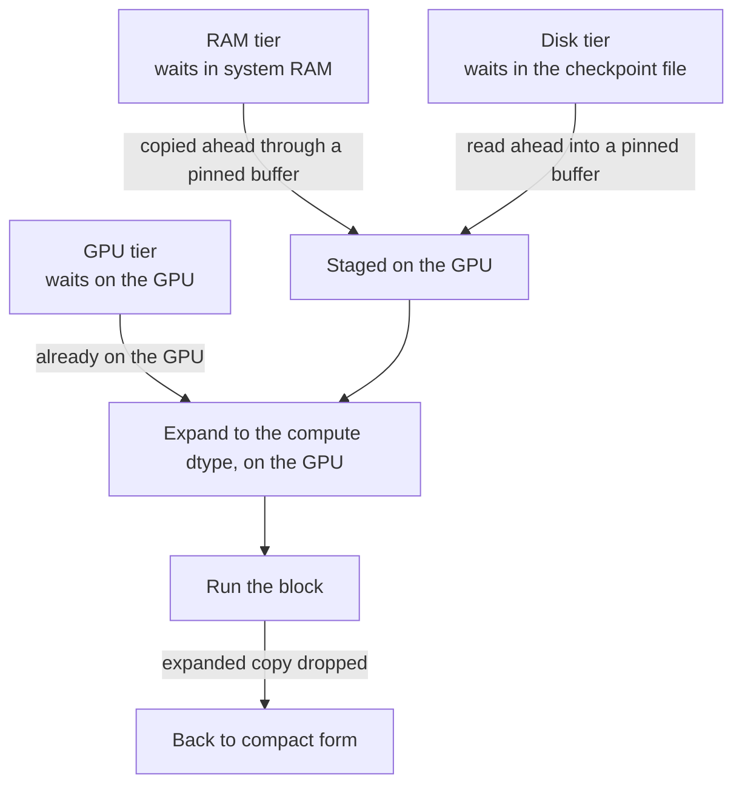
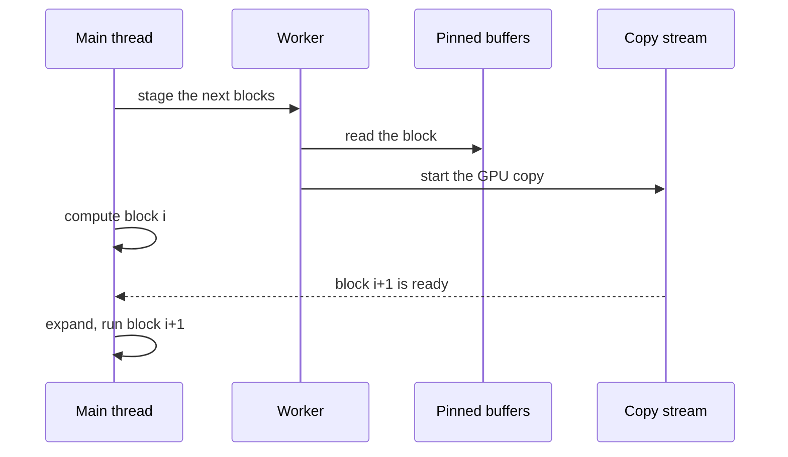
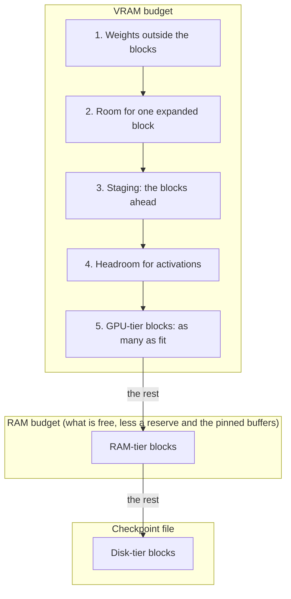
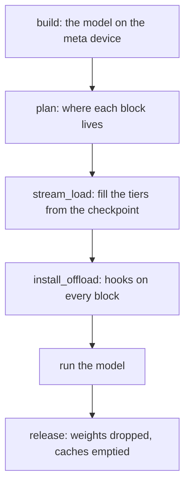
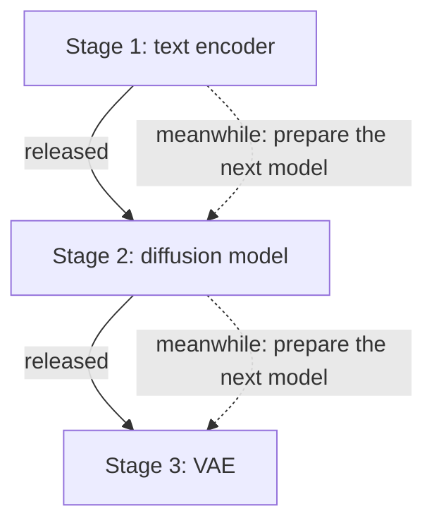

# Design

How trash-panda works, from the big picture down. This page has the concepts; the pages after it have the detail. The
[quick start](../quickstart.md) and the [reference](../reference/index.md) say what to call and with which arguments.

## The idea

A model is built on the meta device, so it has a structure and no weights. The checkpoint is read tensor by tensor, and
each **block** of the model (one layer of a transformer, for example) is put in a **tier** according to what fits.
Weights wait in a compact form, and only the block that runs is expanded to the compute dtype. Peak VRAM is then
roughly one block plus the activations, whatever the model's size.

## Tiers: where a block waits

A block waits in one of three tiers. When it is its turn to run, it goes through the same last steps:

A GPU-tier block only needs the expansion. A RAM-tier block is copied to the GPU first, and a disk-tier block is read
from the file first. Both are done ahead of time, while an earlier block computes.

## A forward pass: prefetching

The order in which the blocks run is known before the first call (it is saved in an order file from the previous run),
so the next blocks can be prepared while the current one computes. A worker thread moves them to the GPU through a few
**pinned** (page-locked) buffers, on a separate CUDA stream, and the main thread waits only if a block is not there yet:

The look-ahead (how many blocks are staged ahead, 2 by default) and the number of pinned buffers are settings. If the
copies are slower than the compute, the main thread waits; the [profile](profile.md) shows how much.

## What a plan reserves

`plan()` decides the tier of every block from the checkpoint's sizes and the memory that is free. It first reserves what
the model needs besides its blocks, then fills what is left:

The blocks that do not fit on the GPU go to RAM, and the ones that do not fit in RAM stay in the file (unless disk is
switched off). Every number here can be overridden; see [planning in practice](planning.md).

## The life of a model: a stage

`stage()` runs the whole sequence for one model and gives all the memory back at the end:

Releasing a stage before the next one is planned lets the next plan see the memory the first one gave back. Details:
[stages in detail](stages.md).

## Several models: a pipeline

A pipeline runs its models one after another, for example a text encoder, a diffusion model and a VAE. A `Coordinator`
owns one pinned pool for all of them. While a stage runs, it can prepare the next one:

The dotted arrows happen while the earlier stage computes. Reading early moves reads, it does not remove them, so it
saves time only when the running stage is long enough to hide them. On a slow drive it can cost time instead, which is
why the RAM tier and the GPU blocks can be prepared separately. Details:
[loading the next model early](loading-the-next-model.md) and [what we measured](measurements.md).

## Read more

* [Planning in practice](planning.md): how plans are made and edited, and how to size the VRAM headroom.
* [Stages in detail](stages.md): loading, running and releasing a model, the order of its blocks, overlap, the final
  pass and the release events.
* [Loading the next model early](loading-the-next-model.md): `preload()`, early loading into free VRAM, and when it pays
  off.
* [Pipelines in detail](pipelines.md): the shared pinned pool and how the next model is prepared.
* [Settings in detail](settings.md): the full description of every tuning setting.
* [What we measured](measurements.md): the numbers behind the defaults and the recommendation.
* [Reading the profile](profile.md): what the output of `TRASH_PANDA_PROFILE=1` means.
